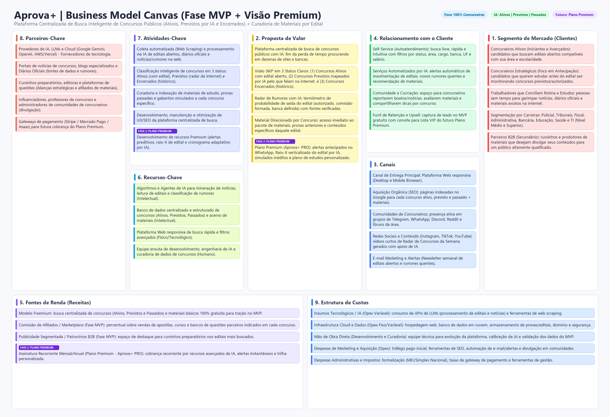
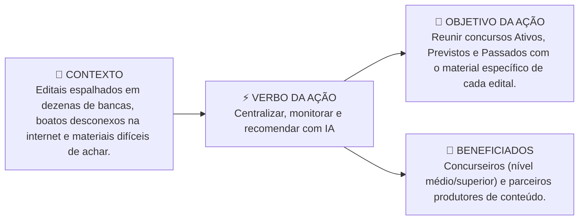
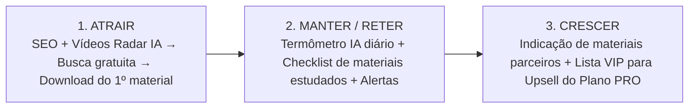

# 🚀 Aprova+ IA — Business Model Canvas & MVP Teórico

---

## 1. Ajustes Aplicados no Novo Business Model Canvas

| Frente do Modelo | Antes | Agora (Aprova+ IA) |
| :--- | :--- | :--- |
| **Segmento de Clientes** | Misturava vestibulares, ENEM, escolas e concursos. | Foco 100% em **Concurseiros** (iniciantes, avançados/pré-edital e trabalhadores) + **Parceiros B2B** (cursinhos e editoras). |
| **Proposta de Valor** | Busca genérica de provas e vestibulares abertos. | **Busca Centralizada com IA nos 3 Status**: **(1) Ativos com Edital**, **(2) Previstos na Internet (Radar IA)** e **(3) Já Aconteceram (Histórico)** + **Materiais vinculados a cada concurso**. |
| **Fases do Produto** | Misturava recursos futuros com o lançamento inicial. | Separação clara entre o **MVP Atual (Gratuito)** e a **Fase 2 Futura (Plano Premium — Aprova+ PRO)**. |
| **Relacionamento** | Confundia funcionalidades do produto com canais de relação. | Estruturado em **Autoatendimento (Self-Service)**, **Automação por IA**, **Comunidade** e **Cocriação**. |
| **Operação (Atividades e Recursos)** | Modelo pesado de cursinho tradicional (professores próprios). | **Plataforma Agregadora & IA**: coleta automatizada de dados, classificação de rumores/editais e curadoria de materiais. |
| **Custos e Receitas** | Cartões sobrepostos e sem divisão por fase. | Layout limpo com receitas **Freemium/Afiliados (MVP)** + **Assinatura Recorrente (Fase 2)** e estrutura enxuta de custos Cloud/IA. |

---

## 2. Business Model Canvas Corrigido

---

## 3. Definição do Problema e Pesquisa

### 3.1. Estrutura do Problema

* **Contexto:** As informações sobre concursos públicos estão pulverizadas em dezenas de bancas organizadoras, Diários Oficiais, fóruns e portais de notícias. Além disso, o concurseiro perde horas procurando provas passadas e materiais compatíveis com cada edital.
* **Dores Principais:**
  1. Perda de prazos de inscrição de concursos abertos.
  2. Dificuldade em separar boatos falsos de movimentações reais na internet sobre concursos previstos.
  3. Falta de histórico rápido (última banca, nota de corte e provas anteriores).
  4. Tempo perdido garimpando apostilas e PDFs alinhados ao edital.
* **Verbo da Ação:** Centralizar, monitorar e recomendar com Inteligência Artificial.
* **Objetivo:** Entregar em um único painel os concursos **Ativos**, **Previstos na Internet** e **Encerrados**, já conectados ao **material específico** de cada concurso.
* **Envolvidos:** Concurseiros (beneficiados diretos) e cursinhos/produtores de materiais (parceiros).

### 3.2. Planejamento da Pesquisa de Validação

| Etapa | Definição |
| :--- | :--- |
| **1. O que descobrir?** | • Quantos sites o concurseiro acessa por semana para buscar editais e notícias? • Ele estuda antes do edital (previstos) ou só após a publicação (ativos)? • Qual a maior dificuldade ao procurar materiais e provas anteriores? • Qual recurso do futuro **Plano Premium** gera maior interesse e disposição de pagamento? |
| **2. Com quem falar?** | • **Iniciantes / Nível Médio:** foco em concursos de amplo volume (Caixa, Correios, INSS, TJ-SP). • **Avançados (Pré-Edital):** foco em carreiras Policiais (PF, PRF), Tribunais e Fiscais. • **Trabalhadores:** candidatos que dispõem de 2h a 4h diárias e precisam de curadoria pronta. |
| **3. Como abordar?** | • Grupos de concurseiros no Telegram, WhatsApp, Discord e Reddit. • Perfis de notícias de concursos no Instagram, TikTok e YouTube. • Formulário integrado ao **Teste de Fumaça (Smoke Test)** dentro do próprio MVP. |

---

## 4. Proposta de Valor e Segmento de Clientes

### 4.1. Mapa de Empatia do Concurseiro

| Dimensão | Perfil do Concurseiro |
| :--- | :--- |
| **O que Pensa e Sente** | Ansiedade com prazos, dúvida se um concurso previsto vai sair mesmo e frustração por perder tempo procurando materiais. |
| **O que Ouve** | Boatos diários sobre autorizações de editais, pressão familiar por aprovação e ofertas de assinaturas caras. |
| **O que Vê** | Dezenas de abas abertas, sites antigos poluídos de anúncios, páginas confusas de bancas e grupos cheios de mensagens sem filtro. |
| **O que Diz e Faz** | Pergunta em grupos sobre provas passadas, situação de bancas e apostilas; acumula pastas de PDFs desorganizados. |
| **Dores (Barreiras)** | Falta de tempo, excesso de *clickbait* sobre concursos previstos, dificuldade de achar material específico e orçamento curto. |
| **Ganhos (Necessidades)** | Ter um painel único e confiável com o que está aberto, o que vai abrir (com probabilidade real) e o material exato para estudar. |

### 4.2. Encaixe Produto × Cliente (Value Proposition Canvas)

| Perfil do Cliente (Concurseiro) | Mapa de Valor (Aprova+ IA) |
| :--- | :--- |
| **Tarefas:** Descobrir editais abertos, acompanhar concursos previstos e baixar materiais/provas do certame. | **Produtos e Serviços:** Busca centralizada IA (3 status), Radar IA de rumores da web, Central de Materiais por edital e futuro Plano PRO. |
| **Dores:** Perder inscrições, cair em boatos falsos na internet e estudar material fora do edital. | **Aliviadores de Dor:** Centralização em tela única, Termômetro IA de confiança de rumores e materiais vinculados direto ao concurso. |
| **Ganhos:** Antecipar estudos antes do edital, economizar tempo e focar apenas no que cai na prova. | **Criadores de Ganho:** Raio-X de disciplinas por peso, simulador de Match de perfil e alertas inteligentes. |

### 4.3. Declaração da Proposta de Valor

> A plataforma **Aprova+ IA** ajuda **concurseiros** que querem **encontrar rapidamente concursos abertos, antecipar-se aos concursos previstos na internet e acessar o material exato de cada edital**, reduzindo **o tempo perdido em sites fragmentados e boatos sem fonte** e aumentando **as chances de aprovação com monitoramento por IA e curadoria direta de materiais**, diferentemente de **portais estáticos de listagem ou cursinhos caros e genéricos**.

---

## 5. Canais (Comunicação, Distribuição e Vendas)

* **Entrega / Distribuição:** Plataforma Web responsiva (acesso direto via desktop e mobile).
* **Vendas / Monetização:** Links rastreados de afiliados (Fase MVP) e checkout próprio de assinatura recorrente (Fase 2 — Plano Premium).
* **Aquisição (Metodologia Bullseye):**
  * **Anel Intermediário (6 canais promissores):** SEO, Comunidades (Telegram/Reddit), Vídeos Curtos (Reels/TikTok/Shorts), Ferramentas Gratuitas (Edital Verticalizado IA), Newsletter de Alertas e Parcerias com Professores.
  * **🎯 Centro do Alvo (Top 3 Canais Foco no MVP):**
    1. **SEO (Busca Orgânica):** Páginas otimizadas para cada concurso ativo, previsto e passado.
    2. **Comunidades de Concurseiros:** Distribuição direta em grupos de Telegram, WhatsApp e Reddit.
    3. **Vídeos Curtos com Radar IA:** Conteúdo diário mostrando editais abertos e o termômetro de rumores da semana.

---

## 6. Relacionamento com Clientes

### 6.1. Modelos de Relacionamento Utilizados
1. **Self-Service (Autoatendimento):** Busca, filtros, favoritos e download de materiais 100% autônomos.
2. **Serviços Automatizados (IA):** Recomendação de perfil, cronograma semanal automático e avisos de mudança de status de concursos.
3. **Comunidade:** Validação coletiva da relevância dos rumores monitorados.
4. **Cocriação:** Envio de novas notícias/rumores pelos próprios usuários para classificação automática da IA.

### 6.2. Funil Duplo de Relacionamento

* **Expectativa do Cliente:** Relacionamento ágil, transparente sobre as fontes das notícias e sem spam.
* **Custo do Relacionamento:** Baixíssimo custo marginal (< R$ 0,15 por usuário ativo/mês) graças à automação por IA e ao autoatendimento.

---

## 7. Atividades-Chave, Recursos-Chave e Parceiros-Chave

### 7.1. Atividades-Chave
* **Coleta e Monitoramento:** Varredura de Diários Oficiais, sites de bancas e portais de notícias.
* **Processamento com IA:** Classificação dos concursos em **Ativos**, **Previstos** e **Passados**, cálculo de probabilidade de edital e verticalização das disciplinas.
* **Curadoria de Materiais:** Vinculação de apostilas, editais verticalizados e provas anteriores a cada concurso.
* **Crescimento e Relacionamento:** Otimização de SEO, atualização do Radar IA e captação de leads para o Plano Premium.

### 7.2. Recursos-Chave
* **Tecnológicos:** Servidor backend (FastAPI), banco de dados relacional (SQLite/PostgreSQL) e interface web responsiva.
* **Intelectuais:** Motor de IA para análise de editais e rumores, base estruturada de concursos e acervo indexado de materiais.
* **Humanos:** Equipe enxuta de desenvolvimento Full-Stack/IA, curadoria de conteúdo e marketing de crescimento.
* **Financeiros:** *Bootstrapping* de baixo custo inicial complementado por receitas de afiliados.

### 7.3. Parceiros-Chave
* **Fornecedores de Tecnologia:** Provedores de APIs de IA (LLMs) e hospedagem em nuvem.
* **Parceiros Estratégicos de Conteúdo:** Cursinhos preparatórios, editoras de apostilas, plataformas de questões e professores independentes (fornecem materiais completos em troca de tráfego qualificado e comissão sobre vendas).

---

## 8. Fontes de Receita e Estrutura de Custos

### 8.1. Fontes de Receita ("Conta de Padaria")

| Público | Modelo de Monetização | Preço e Estimativa Inicial |
| :--- | :--- | :--- |
| **Usuário Gratuito (MVP)** | Acesso livre à busca (3 status), Radar IA e materiais básicos; monetizado via indicação de materiais completos. | **Gratuito para o concurseiro** (gera tráfego e conversão de afiliados). |
| **Parceiros B2B (MVP)** | Comissão de afiliados (CPA) sobre cursos/apostilas vendidos + destaque patrocinado. | Comissão média de **R$ 35,00/venda** + patrocínios (**~R$ 2.000,00 no 1º mês**). |
| **Assinante Aprova+ PRO (Fase 2 Futura)** | Assinatura recorrente (Alertas WhatsApp em tempo real, Corretor IA e Cronograma Adaptativo). | **R$ 29,90/mês** (ou R$ 19,90/mês no plano anual) → **~R$ 145 mil a R$ 213 mil no 1º ano**. |

### 8.2. Estrutura dos 6 Custos Principais

| Categoria | Aplicação no Aprova+ IA | Estimativa Mensal (Fase MVP) |
| :--- | :--- | :--- |
| **1. Matéria-prima / Insumos Digitais** | Consumo de APIs de IA (tokens) e serviços de captura de dados web. | R$ 150 a R$ 450/mês |
| **2. Mão de Obra Direta** | Desenvolvimento Full-Stack, manutenção da IA e curadoria de editais/materiais. | R$ 0 (sócios no MVP) → R$ 4.400+/mês na escala |
| **3. Mão de Obra Indireta** | Produção de conteúdo para redes sociais, comunidade e suporte. | R$ 300 a R$ 800/mês |
| **4. Despesas Administrativas** | Contabilidade digital, formalização e taxas de meios de pagamento. | R$ 150 a R$ 680/mês |
| **5. Infraestrutura** | Hospedagem em nuvem, banco de dados, armazenamento de PDFs e domínio. | R$ 80 a R$ 350/mês |
| **6. Impostos** | Simples Nacional / MEI sobre faturamento bruto. | 6% sobre a receita |

---

## 9. Planejamento e Validação do MVP

### 9.1. Composição do MVP
1. **Protótipo Funcional Full-Stack:** Plataforma web real com busca nos **3 status** (Ativos, Previstos na Internet e Passados), **Materiais vinculados a cada concurso** e **Copiloto IA**.
2. **Operação Enxuta (Concierge / Semi-automatizada):** Curadoria ágil dos editais, rumores e materiais garantindo entrega imediata de valor sem custo inicial elevado de servidores.
3. **Teste de Fumaça (*Smoke Test*) para o Plano Premium:** Aba dedicada ao futuro **Aprova+ PRO** com formulário de Lista VIP para medir a demanda real e o preço ideal antes do desenvolvimento da Fase 2.

### 9.2. Roteiro de Validação em 4 Passos

| Etapa | Definição no Projeto Aprova+ IA |
| :--- | :--- |
| **1. Hipóteses a Testar** | • **H1 (Busca Centralizada):** Concurseiros preferem buscar concursos Ativos, Previstos e Passados em um único lugar. • **H2 (Radar IA):** O termômetro de rumores da internet atrai candidatos para o estudo pré-edital. • **H3 (Materiais por Edital):** Ter o material vinculado direto ao concurso gera alto índice de downloads e estudo. • **H4 (Plano Premium Futuro):** Há interesse real em pagar R$ 29,90/mês pelos recursos avançados da Fase 2. |
| **2. Perguntas de Aprendizado** | • Os usuários utilizam os filtros dos 3 status? • Qual aba retém mais atenção: editais abertos ou rumores previstos na internet? • Os concurseiros baixam e marcam os materiais específicos de cada concurso? • Qual recurso futuro do Plano PRO é o mais votado no cadastro VIP? |
| **3. Métricas Auditadas** | • **M1:** `% de visitantes` que realizam buscas/filtros. • **M2:** `% de visitantes` que interagem com o Radar IA de previstos. • **M3:** `Taxa de cliques/downloads` nos materiais vinculados aos concursos. • **M4:** `% de conversão` de inscritos na Lista VIP do Plano Premium (Smoke Test). |
| **4. Critério de Validação (Amostra: 400 concurseiros)** | • **H1 validada se:** $\ge 60\%$ (240 usuários) utilizarem a busca/filtros de status. • **H2 validada se:** $\ge 45\%$ (180 usuários) consultarem o Radar IA de previstos. • **H3 validada se:** $\ge 35\%$ (140 usuários) baixarem/abrirem materiais de um concurso. • **H4 validada se:** $\ge 15\%$ (60 leads) se inscreverem na Lista VIP aceitando a faixa de R$ 29,90/mês. |

---

## 10. Arquivos do Projeto

* **Plataforma MVP Full-Stack (`frontend/` + `backend/`):** pasta [`mvp/`](file:///c:/Users/carlo/OneDrive/Desktop/Projeto/mvp/) (inicie com [`iniciar_mvp.bat`](file:///c:/Users/carlo/OneDrive/Desktop/Projeto/mvp/iniciar_mvp.bat) ou acesse [`mvp/frontend/index.html`](file:///c:/Users/carlo/OneDrive/Desktop/Projeto/mvp/frontend/index.html))
* **Imagem do Canvas Corrigido:** [`canvas_corrigido.png`](file:///c:/Users/carlo/OneDrive/Desktop/Projeto/canvas_corrigido.png) e [`canvas_corrigido.pdf`](file:///c:/Users/carlo/OneDrive/Desktop/Projeto/canvas_corrigido.pdf)
* **Planilha Financeira (5 Anos):** [`Modelagem_Financeira_AprovaMais.xlsx`](file:///c:/Users/carlo/OneDrive/Desktop/Projeto/Modelagem_Financeira_AprovaMais.xlsx)
