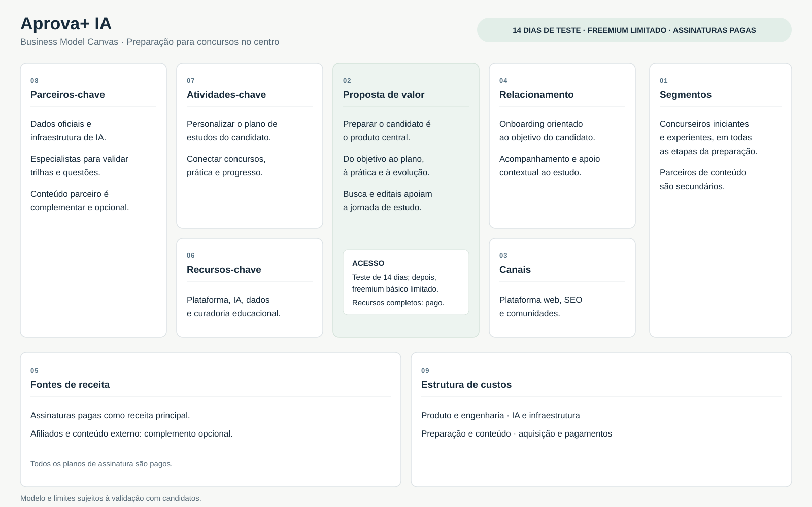
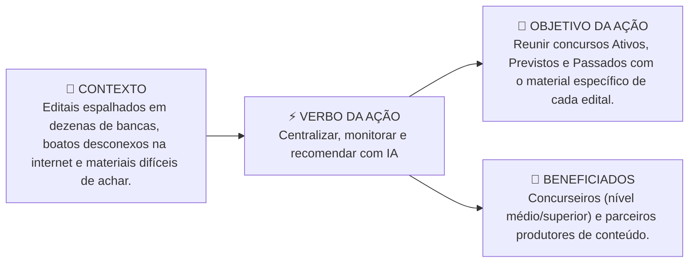
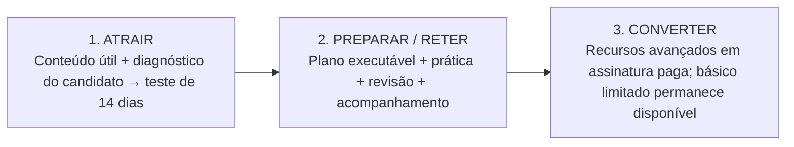

# 🚀 Aprova+ IA — Business Model Canvas & MVP Teórico

---

## 1. Ajustes Aplicados no Novo Business Model Canvas

| Frente do Modelo | Antes | Agora (Aprova+ IA) |
| :--- | :--- | :--- |
| **Segmento de Clientes** | Misturava vestibulares, ENEM, escolas e concursos. | Foco 100% em **Concurseiros** (iniciantes, avançados/pré-edital e trabalhadores) + **Parceiros B2B** (cursinhos e editoras). |
| **Proposta de Valor** | Busca genérica de provas e vestibulares abertos. | Preparação como núcleo: o candidato escolhe um objetivo, recebe direção de estudo, executa um plano e acompanha evolução; busca e monitoramento de concursos apoiam essa jornada. |
| **Acesso e Planos** | MVP gratuito e recursos de preparação concentrados em um Premium futuro. | **Teste de 14 dias** dos recursos de preparação; depois, acesso **freemium básico e limitado** ou assinatura. Todos os planos de assinatura são pagos. |
| **Relacionamento** | Confundia funcionalidades do produto com canais de relação. | Estruturado em **Autoatendimento (Self-Service)**, **Automação por IA**, **Comunidade** e **Cocriação**. |
| **Operação (Atividades e Recursos)** | Modelo pesado de cursinho tradicional (professores próprios). | **Plataforma Agregadora & IA**: coleta automatizada de dados, classificação de rumores/editais e curadoria de materiais. |
| **Custos e Receitas** | A receita dependia de afiliados e de cursos de terceiros, com assinatura adiada. | Assinaturas pagas como receita principal; afiliados e conteúdo parceiro são complementares, sem substituir a preparação oferecida pelo Aprova+ IA. |

---

## 2. Business Model Canvas Corrigido

---

## 3. Definição do Problema e Pesquisa

### 3.1. Estrutura do Problema

* **Contexto:** As informações sobre concursos públicos estão pulverizadas em dezenas de bancas organizadoras, Diários Oficiais, fóruns e portais de notícias. Além disso, o concurseiro perde horas procurando provas passadas e materiais compatíveis com cada edital.
* **Dores Principais:**
  1. Perda de prazos de inscrição de concursos abertos.
  2. Dificuldade em separar boatos falsos de movimentações reais na internet sobre concursos previstos.
  3. Falta de histórico rápido (última banca, nota de corte e provas anteriores).
  4. Tempo perdido garimpando apostilas e PDFs alinhados ao edital.
* **Verbo da Ação:** Centralizar, monitorar e recomendar com Inteligência Artificial.
* **Objetivo:** Entregar em um único painel os concursos **Ativos**, **Previstos na Internet** e **Encerrados**, já conectados ao **material específico** de cada concurso.
* **Envolvidos:** Concurseiros (beneficiados diretos) e cursinhos/produtores de materiais (parceiros).

### 3.2. Planejamento da Pesquisa de Validação

| Etapa | Definição |
| :--- | :--- |
| **1. O que descobrir?** | • Como o candidato organiza hoje seu plano de preparação e sua rotina de estudos? • Quais atividades de preparação geram uso recorrente: cronograma, questões, revisão, copiloto ou acompanhamento? • Como a busca de concursos e o Radar IA ajudam a escolher o objetivo de estudo? • Qual valor o candidato atribui ao teste de 14 dias, ao acesso básico limitado e à assinatura paga? |
| **2. Com quem falar?** | • **Iniciantes / Nível Médio:** foco em concursos de amplo volume (Caixa, Correios, INSS, TJ-SP). • **Avançados (Pré-Edital):** foco em carreiras Policiais (PF, PRF), Tribunais e Fiscais. • **Trabalhadores:** candidatos que dispõem de 2h a 4h diárias e precisam de curadoria pronta. |
| **3. Como abordar?** | • Grupos de concurseiros no Telegram, WhatsApp, Discord e Reddit. • Perfis de notícias de concursos no Instagram, TikTok e YouTube. • Formulário integrado ao **Teste de Fumaça (Smoke Test)** dentro do próprio MVP. |

---

## 4. Proposta de Valor e Segmento de Clientes

### 4.1. Mapa de Empatia do Concurseiro

| Dimensão | Perfil do Concurseiro |
| :--- | :--- |
| **O que Pensa e Sente** | Ansiedade com prazos, dúvida se um concurso previsto vai sair mesmo e frustração por perder tempo procurando materiais. |
| **O que Ouve** | Boatos diários sobre autorizações de editais, pressão familiar por aprovação e ofertas de assinaturas caras. |
| **O que Vê** | Dezenas de abas abertas, sites antigos poluídos de anúncios, páginas confusas de bancas e grupos cheios de mensagens sem filtro. |
| **O que Diz e Faz** | Pergunta em grupos sobre provas passadas, situação de bancas e apostilas; acumula pastas de PDFs desorganizados. |
| **Dores (Barreiras)** | Falta de tempo, excesso de *clickbait* sobre concursos previstos, dificuldade de achar material específico e orçamento curto. |
| **Ganhos (Necessidades)** | Ter um painel único e confiável com o que está aberto, o que vai abrir (com probabilidade real) e o material exato para estudar. |

### 4.2. Encaixe Produto × Cliente (Value Proposition Canvas)

| Perfil do Cliente (Concurseiro) | Mapa de Valor (Aprova+ IA) |
| :--- | :--- |
| **Tarefas:** Definir um objetivo, organizar a rotina, estudar com consistência, praticar questões, revisar e acompanhar a evolução; também descobrir editais e concursos adequados. | **Produtos e Serviços:** Jornada de preparação com perfil, plano de estudos, revisões, questões, acompanhamento e copiloto IA; busca nos 3 status e materiais por edital como apoio. |
| **Dores:** Perder inscrições, cair em boatos falsos na internet e estudar material fora do edital. | **Aliviadores de Dor:** Centralização em tela única, Termômetro IA de confiança de rumores e materiais vinculados direto ao concurso. |
| **Ganhos:** Antecipar estudos antes do edital, economizar tempo e focar apenas no que cai na prova. | **Criadores de Ganho:** Raio-X de disciplinas por peso, simulador de Match de perfil e alertas inteligentes. |

### 4.3. Declaração da Proposta de Valor

> A plataforma **Aprova+ IA** ajuda **concurseiros** que querem **encontrar rapidamente concursos abertos, antecipar-se aos concursos previstos na internet e acessar o material exato de cada edital**, reduzindo **o tempo perdido em sites fragmentados e boatos sem fonte** e aumentando **as chances de aprovação com monitoramento por IA e curadoria direta de materiais**, diferentemente de **portais estáticos de listagem ou cursinhos caros e genéricos**.

---

## 5. Canais (Comunicação, Distribuição e Vendas)

* **Entrega / Distribuição:** Plataforma Web responsiva (acesso direto via desktop e mobile).
* **Vendas / Monetização:** Teste de 14 dias dos recursos de preparação, acesso básico freemium limitado após o teste e assinaturas pagas para os recursos completos. Afiliados de materiais externos podem complementar a receita, mas não são o modelo principal.
* **Aquisição (Metodologia Bullseye):**
  * **Anel Intermediário (6 canais promissores):** SEO, Comunidades (Telegram/Reddit), Vídeos Curtos (Reels/TikTok/Shorts), Ferramentas Gratuitas (Edital Verticalizado IA), Newsletter de Alertas e Parcerias com Professores.
  * **🎯 Centro do Alvo (Top 3 Canais Foco no MVP):**
    1. **SEO (Busca Orgânica):** Páginas otimizadas para cada concurso ativo, previsto e passado.
    2. **Comunidades de Concurseiros:** Distribuição direta em grupos de Telegram, WhatsApp e Reddit.
    3. **Vídeos Curtos com Radar IA:** Conteúdo diário mostrando editais abertos e o termômetro de rumores da semana.

---

## 6. Relacionamento com Clientes

### 6.1. Modelos de Relacionamento Utilizados
1. **Self-Service (Autoatendimento):** Plano de estudos, prática, revisão, progresso e busca de concursos em fluxo autônomo.
2. **Serviços Automatizados (IA):** Recomendação de perfil, cronograma semanal, apoio contextual ao estudo e avisos relevantes de concursos.
3. **Comunidade:** Validação coletiva da relevância dos rumores monitorados.
4. **Cocriação:** Envio de novas notícias/rumores pelos próprios usuários para classificação automática da IA.

### 6.2. Funil Duplo de Relacionamento

* **Expectativa do Cliente:** Relacionamento ágil, transparente sobre as fontes das notícias e sem spam.
* **Custo do Relacionamento:** Baixíssimo custo marginal (< R$ 0,15 por usuário ativo/mês) graças à automação por IA e ao autoatendimento.

---

## 7. Atividades-Chave, Recursos-Chave e Parceiros-Chave

### 7.1. Atividades-Chave
* **Coleta e Monitoramento:** Varredura de Diários Oficiais, sites de bancas e portais de notícias.
* **Processamento com IA:** Classificação dos concursos em **Ativos**, **Previstos** e **Passados**, cálculo de probabilidade de edital e verticalização das disciplinas.
* **Curadoria de Materiais:** Vinculação de apostilas, editais verticalizados e provas anteriores a cada concurso.
* **Crescimento e Relacionamento:** Otimização de SEO, ativação do teste de 14 dias, acompanhamento da preparação e conversão transparente para assinatura.

### 7.2. Recursos-Chave
* **Tecnológicos:** Servidor backend (FastAPI), banco de dados relacional (SQLite/PostgreSQL) e interface web responsiva.
* **Intelectuais:** Motor de IA para análise de editais e rumores, base estruturada de concursos e acervo indexado de materiais.
* **Humanos:** Equipe enxuta de desenvolvimento Full-Stack/IA, curadoria de conteúdo e marketing de crescimento.
* **Financeiros:** Receita prioritária de assinaturas; comissões por conteúdo parceiro são acessórias e não pressupõem que o parceiro forneça a preparação central do produto.

### 7.3. Parceiros-Chave
* **Fornecedores de Tecnologia:** Provedores de APIs de IA (LLMs) e hospedagem em nuvem.
* **Parceiros Estratégicos Complementares:** Editoras, plataformas de questões e professores podem ampliar o catálogo por licenciamento ou indicação afiliada. A plataforma mantém sua própria experiência de preparação; parcerias com cursinhos não são a proposta de valor nem a fonte de receita central.

---

## 8. Fontes de Receita e Estrutura de Custos

### 8.1. Fontes de Receita ("Conta de Padaria")

| Público | Modelo de Monetização | Preço e Estimativa Inicial |
| :--- | :--- | :--- |
| **Teste de 14 dias** | Experimentação dos recursos de preparação para o candidato avaliar valor antes de decidir. | Duração proposta: **14 dias**; recursos incluídos e eventual exigência de meio de pagamento devem ser definidos com transparência. |
| **Acesso freemium básico** | Permanece disponível após o teste, com limites que permitem uma experiência inicial, sem acesso ilimitado à preparação avançada. | Gratuito, com limites de uso e funcionalidades a validar; não é um plano de assinatura. |
| **Assinaturas Aprova+** | Planos recorrentes pagos com acesso ampliado à preparação, como cronogramas, revisões, questões, análise de desempenho e recursos avançados de IA. | **Preço e composição dos planos a validar**; R$ 29,90/mês pode ser uma hipótese de pesquisa, não uma decisão fechada. |
| **Receita complementar** | Comissões transparentes por materiais ou cursos externos que complementem a preparação do candidato. | Secundária e opcional; não incluir projeções de comissão/patrocínio como receita-base sem validação. |

### 8.2. Estrutura dos 6 Custos Principais

| Categoria | Aplicação no Aprova+ IA | Estimativa Mensal (Fase MVP) |
| :--- | :--- | :--- |
| **1. Matéria-prima / Insumos Digitais** | Consumo de APIs de IA (tokens) e serviços de captura de dados web. | R$ 150 a R$ 450/mês |
| **2. Mão de Obra Direta** | Desenvolvimento Full-Stack, manutenção da IA e curadoria de editais/materiais. | R$ 0 (sócios no MVP) → R$ 4.400+/mês na escala |
| **3. Mão de Obra Indireta** | Produção de conteúdo para redes sociais, comunidade e suporte. | R$ 300 a R$ 800/mês |
| **4. Despesas Administrativas** | Contabilidade digital, formalização e taxas de meios de pagamento. | R$ 150 a R$ 680/mês |
| **5. Infraestrutura** | Hospedagem em nuvem, banco de dados, armazenamento de PDFs e domínio. | R$ 80 a R$ 350/mês |
| **6. Impostos** | Simples Nacional / MEI sobre faturamento bruto. | 6% sobre a receita |

---

## 9. Planejamento e Validação do MVP

### 9.1. Composição do MVP
1. **Preparação como fluxo principal:** Onboarding de perfil e objetivo, plano de estudos inicial, rotina de prática/revisão e acompanhamento; a busca nos **3 status** e os materiais por concurso alimentam esse fluxo.
2. **Operação Enxuta (Concierge / Semi-automatizada):** Curadoria ágil dos editais, rumores e materiais garantindo entrega imediata de valor sem custo inicial elevado de servidores.
3. **Acesso e monetização:** Validar um **teste de 14 dias**, seguido de freemium básico limitado e convite claro para assinatura paga. O fluxo de preparação não deve ser reduzido a uma lista VIP para um produto futuro.

### 9.2. Roteiro de Validação em 4 Passos

| Etapa | Definição no Projeto Aprova+ IA |
| :--- | :--- |
| **1. Hipóteses a Testar** | • **H1 (Preparação):** Um plano de estudos personalizado, prática e acompanhamento resolvem dores mais relevantes do que apenas encontrar concursos. • **H2 (Ativação):** O teste de 14 dias leva o candidato a iniciar uma rotina real de preparação. • **H3 (Freemium):** O acesso básico limitado oferece valor sem eliminar o motivo para assinar. • **H4 (Receita):** Candidatos convertem para assinatura paga por recursos de preparação; parceiros de conteúdo são complementares. |
| **2. Perguntas de Aprendizado** | • O candidato conclui onboarding e começa um plano de estudo? • Quais ações de preparação são usadas repetidamente durante o teste? • Que limites do acesso básico preservam valor sem bloquear a experiência inicial? • Qual proposta e faixa de preço convertem para assinatura paga? • Conteúdo externo complementa o estudo ou gera conflito com a proposta própria? |
| **3. Métricas Auditadas** | • **M1:** ativação: candidatos que definem objetivo e começam um plano. • **M2:** frequência de sessões de estudo, revisões e questões concluídas. • **M3:** retenção e evolução de progresso durante os 14 dias. • **M4:** conversão do teste para assinatura paga e permanência após conversão. • **M5:** uso do freemium básico e receita complementar de parceiros, quando aplicável. |
| **4. Critério de Validação (Amostra: 400 concurseiros)** | Manter a amostra como referência de pesquisa e definir metas quantitativas após instrumentar a linha de base. Não usar os antigos percentuais de busca/lista VIP como validação do modelo de preparação; medir ativação, uso recorrente, conversão e retenção. |

---

## 10. Arquivos do Projeto

* **Plataforma MVP Full-Stack (`frontend/` + `backend/`):** pasta [`mvp/`](file:///c:/Users/carlo/OneDrive/Desktop/Projeto/mvp/) (inicie com [`iniciar_mvp.bat`](file:///c:/Users/carlo/OneDrive/Desktop/Projeto/mvp/iniciar_mvp.bat) ou acesse [`mvp/frontend/index.html`](file:///c:/Users/carlo/OneDrive/Desktop/Projeto/mvp/frontend/index.html))
* **Canvas atualizado:** [`canvas_corrigido.svg`](./canvas_corrigido.svg) (versão vetorial atualizada).
* **Planilha Financeira (5 Anos):** [`Modelagem_Financeira_AprovaMais.xlsx`](file:///c:/Users/carlo/OneDrive/Desktop/Projeto/Modelagem_Financeira_AprovaMais.xlsx)
