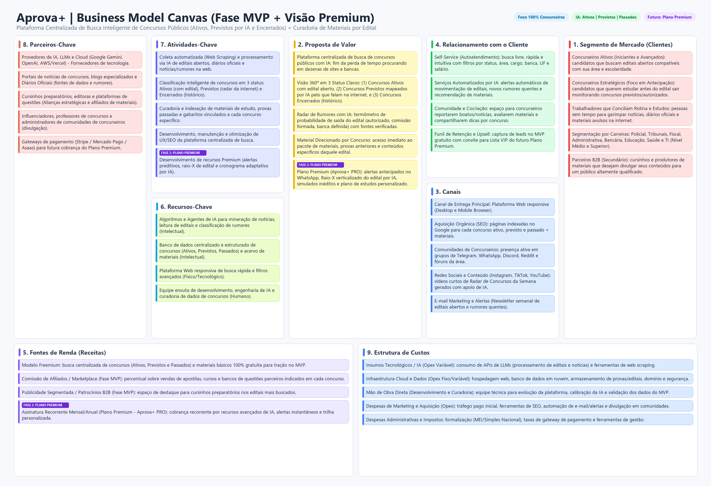

# 🚀 Aprova+ IA — MVP Full-Stack & Documentação

> **🌐 Acesse a Plataforma Online (GitHub Pages):** [**https://lxcas7.github.io/aprova-mais-ia/frontend/**](https://lxcas7.github.io/aprova-mais-ia/frontend/)
>
> **📄 Leia a Documentação do MVP Teórico & Canvas:** [**MVP_Teorico_Completo_AprovaMais.md**](./MVP_Teorico_Completo_AprovaMais.md)

Plataforma centralizada com Inteligência Artificial para busca de **Concursos Públicos** em **3 status** (**Ativos com Edital**, **Previstos pelo que estão falando na internet** e **Encerrados/Históricos**), com **Materiais de Estudo vinculados a cada concurso** e validação de demanda do **Plano Premium (Fase 2 — Smoke Test)**.

---

## 🎨 Business Model Canvas Corrigido (Aprova+ IA)



---

## 📁 Estrutura do Repositório (MVP + Documentação)

```text
aprova-mais-ia/
├── README.md                        # Visão geral do projeto e guia de execução
├── MVP_Teorico_Completo_AprovaMais.md # Documentação limpa do MVP Teórico e Canvas
├── canvas_corrigido.png             # Imagem em alta definição do Business Model Canvas
├── iniciar_mvp.bat                  # Inicializador rápido com 1 clique (Windows)
├── iniciar_mvp.ps1                  # Inicializador via PowerShell
│
├── docs/                            # DOCUMENTAÇÃO E MODELAGEM DO PROJETO
│   ├── MVP_Teorico_Completo_AprovaMais.md
│   ├── canvas_corrigido.png
│   ├── canvas_corrigido.pdf
│   └── Modelagem_Financeira_AprovaMais.xlsx
│
├── backend/                         # BACKEND API REST (Python + FastAPI + SQLite3)
│   ├── main.py                      # Ponto de entrada FastAPI, CORS e servidor estático
│   ├── requirements.txt             # Dependências do servidor
│   ├── config/
│   │   └── settings.py              # Configurações globais e caminho do SQLite
│   ├── database/
│   │   ├── connection.py            # Gerenciador de conexões SQLite (Row factory)
│   │   ├── seed.py                  # Criação de tabelas + carga inicial (13 concursos, 34 materiais, 4 rumores)
│   │   └── aprova_mais.db           # Banco de dados relacional SQLite persistente
│   ├── models/
│   │   └── schemas.py               # Schemas Pydantic para validação de entrada/saída
│   ├── routes/
│   │   ├── concursos_routes.py      # GET /api/concursos, GET /api/concursos/{id}, POST favorito
│   │   ├── materiais_routes.py      # GET /api/materiais, POST estudado, GET download de guia
│   │   ├── radar_routes.py          # GET /api/radar, POST novo rumor, POST voto comunitário
│   │   ├── ia_routes.py             # POST /api/ia/chat, POST /api/ia/match-perfil
│   │   └── mvp_routes.py            # GET /api/mvp/dashboard, POST /api/mvp/leads-premium
│   └── services/
│       ├── ia_engine.py             # Motor de IA (Chat NLP, Match de Perfil e Classificador de Rumores)
│       └── pdf_generator.py         # Gerador dinâmico de Apostilas / Guias Verticalizados para download
│
└── frontend/                        # FRONTEND MODULAR (HTML5 + CSS3 + JavaScript SPA)
    ├── index.html                   # Shell principal da aplicação (6 abas modulares)
    ├── assets/img/
    │   └── canvas_corrigido.png     # Imagem oficial do Business Model Canvas corrigido
    ├── css/
    │   ├── variables.css            # Design System, cores, sombras e tipografia
    │   ├── layout.css               # Navbar, Hero, Grid de filtros e responsividade
    │   └── components.css           # Cards, Badges, Termômetro IA, Modal, Tabelas e Toasts
    └── js/
        ├── app.js                   # Controlador central de estado, rotas e filtros
        ├── api/
        │   ├── client.js            # Cliente HTTP integrado ao FastAPI + Persistência Local no GitHub Pages
        │   └── fallbackData.js      # Base estruturada de concursos, materiais e rumores
        ├── components/
        │   ├── concursoCard.js      # Card individual de concurso (Ativo, Previsto IA, Histórico)
        │   ├── modalDetalhes.js     # Modal Raio-X de disciplinas por peso + checklist de materiais
        │   ├── radarFeed.js         # Feed do Radar IA (rumores da internet) + formulário de cocriação
        │   ├── materiaisHub.js      # Repositório de materiais filtrado por concurso e categoria
        │   ├── iaAssistant.js       # Simulador de Match de Perfil + Cronograma + Chat IA 24/7
        │   ├── smokeTestPremium.js  # Teste de Fumaça do Plano Aprova+ PRO (Fase 2)
        │   └── dashboardMvp.js      # Painel de telemetria em tempo real + Canvas
        └── utils/
            └── formatters.js        # Utilitários visuais e sistema de notificações Toast
```

---

## ▶️ Como Executar

### 1. Acesso Online Imediato (GitHub Pages)
Acesse diretamente pelo navegador sem instalar nada:
- **https://lxcas7.github.io/aprova-mais-ia/frontend/**

### 2. Execução Local Full-Stack (Backend FastAPI + Banco SQLite + Frontend)
Dê um duplo clique em **`iniciar_mvp.bat`** ou rode no terminal:
```powershell
cd backend
pip install -r requirements.txt
python -m uvicorn main:app --host 127.0.0.1 --port 8000 --reload
```
- **Interface Web:** `http://127.0.0.1:8000`
- **Swagger UI (API Docs):** `http://127.0.0.1:8000/docs`
